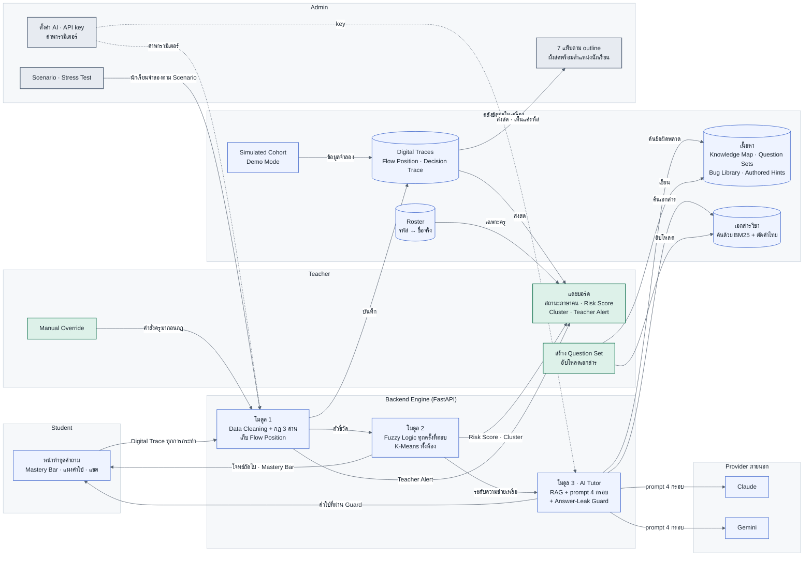
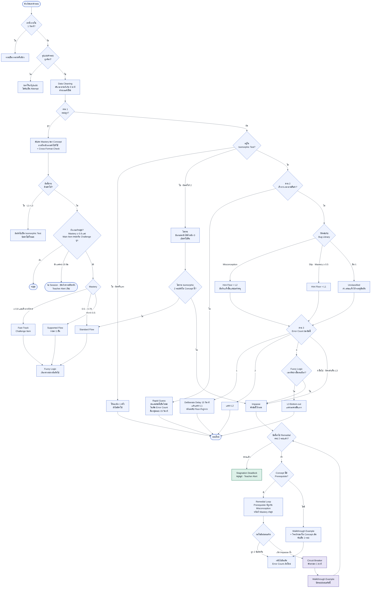
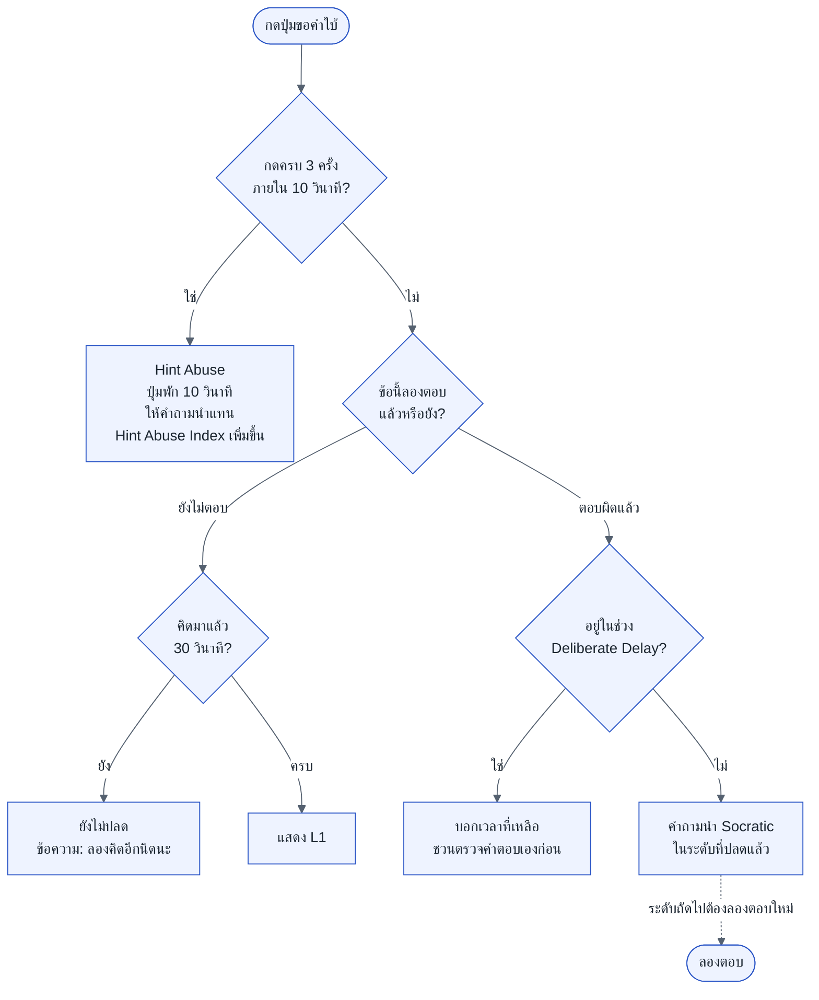
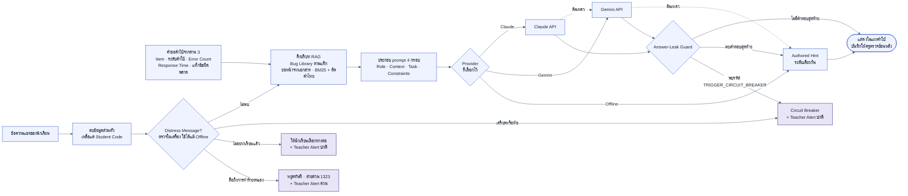

# ผังการทำงาน

ผังชุดเดียวกับที่ใช้ตรวจตรรกะระหว่างออกแบบ คำศัพท์เป็นไปตาม [CONTEXT.md](../CONTEXT.md) และการตัดสินใจทั้งหมดอยู่ใน [decisions.md](decisions.md)

## ผัง 1 · ภาพรวมระบบ

ทุกการกระทำของนักเรียนเข้าโมดูล 1 ก่อนเสมอ หน้าจอนักเรียนได้รับแค่โจทย์ถัดไป แถบ Mastery และคำใบ้ที่ผ่าน Answer-Leak Guard แล้ว Teacher เห็นชื่อจริงผ่าน Roster ส่วน Admin เห็นตัวแปรทุกตัวแต่เห็นนักเรียนเป็นรหัสเท่านั้น

## ผัง 2 · เมื่อนักเรียนส่งคำตอบหนึ่งครั้ง

ฝั่งตอบถูกจะอัปเดต Mastery แล้วเลือก Learning Path ฝั่งตอบผิดไล่จากด่าน 2 (ตอบเร็วเกินไปหรือไม่) ไปวินิจฉัยกับ Bug Library แล้วเข้าด่าน 3 (ผิดเป็นครั้งที่เท่าไร) ทุกทางที่วนกลับมีตัวนับกำกับ วงวนจึงจบที่ครูเสมอเมื่อส่งซ่อมเสริมครบ 2 รอบ

## Flow Position

นักเรียนหนึ่งคนอยู่ได้ทีละตำแหน่ง หน้า Admin วางจุดของนักเรียนบนตำแหน่งเหล่านี้ และทุกการย้ายตำแหน่งบันทึกเหตุผลเป็น Decision Trace ส่วน Learning Path (Fast-Track, Standard, Supported) แสดงเป็นป้ายคู่กับตำแหน่ง ([ADR-0002](adr/0002-named-flow-positions.md))

| Flow Position | เข้ามาเมื่อ | ไปต่อเมื่อ |
|---|---|---|
| กำลังคิด | เปิดโจทย์ใหม่ หลังได้คำใบ้ หรือหลังปลดล็อก | ส่งคำตอบ |
| Deliberate Delay | ผิดครั้งแรก | ครบ 15 วินาทีแล้วได้คำใบ้ หรือแก้เองถูกก่อน |
| ล็อก Rapid Guess | ผิดเร็วกว่าเวลาอ่านขั้นต่ำ | ครบ 15 วินาที กลับไปกำลังคิด |
| Hint L1 · L2 · L3 | ตามบันไดคำใบ้และ Hint Floor | ส่งคำตอบ |
| Isomorphic Test | ผ่านข้อก่อนหน้าด้วยคำใบ้ | ถูก ไปเส้นทางถัดไป · ผิด 2 ครั้ง กลับ Standard Flow |
| Impasse | ผิดครั้งที่ 3 และเวลาคิดยาวขึ้น · ผิดหลังเห็น L3 · ไม่ผ่าน Isomorphic 2 รอบติด | ทันที ไป Remedial Loop หรือ Stagnation Deadlock |
| Remedial Loop รอบ 1 · 2 | Impasse และยังส่งซ่อมเสริมไม่ครบ 2 รอบ | ถูก 2 ข้อติดกัน กลับข้อเดิม · Impasse ซ้ำ ไป Circuit Breaker |
| Circuit Breaker | Impasse ใน Remedial Loop · ข้อความเครียดหรือท้อ | ครบ 1 นาที ไป Walkthrough |
| Walkthrough | หลัง Circuit Breaker · Concept ที่ไม่มี Prerequisite | อ่านจบ ไปตามเงื่อนไขในผัง 2 |
| Idle Pause | ไม่มีการกระทำ 5 นาที | นักเรียนกดทำต่อ กลับตำแหน่งเดิม |
| รอเลือกทางต่อ | ข้อความ "ไม่อยากเรียนแล้ว" | นักเรียนเลือก พักก่อน · ทำต่อแบบง่ายลง · หยุดวันนี้ |
| หยุดเพื่อความปลอดภัย | ข้อความที่สื่อถึงการทำร้ายตนเอง | ครูเป็นคนปลดเท่านั้น |
| Stagnation Deadlock | ส่งซ่อมเสริมครบ 2 รอบแล้วยังติด | ครูสั่ง Manual Override |
| จบชุด | Mastery ของ Target Concept ≥ 0.8 (อย่างน้อย 3 ข้อ) และทำ Main Item ครบหรือทำ Challenge Item ถูก 1 ข้อ · หรือครบ 20 ข้อ (จบ Session พร้อมบันทึกความคืบหน้า) | ไม่มี |

## ผัง 3 · เมื่อกดปุ่มขอคำใบ้

ปุ่มนี้ปลดคำใบ้ระดับใหม่เองไม่ได้ ระดับใหม่ได้จากการลองตอบเท่านั้น คำใบ้ตามบันไดจะขึ้นเองในแผงคำใบ้หลังตอบผิด และระหว่าง Isomorphic Test ปุ่มนี้ถูกซ่อน

## ผัง 4 · AI Tutor สร้างคำใบ้โดยไม่หลุดเฉลย

LLM มีหน้าที่แค่ปรับถ้อยคำ ทุกข้อความต้องผ่าน Answer-Leak Guard ก่อนถึงนักเรียน ถ้าถูกบล็อกหรือ Provider ใช้ไม่ได้ ระบบจะใช้คำใบ้ที่ครูเขียนไว้แทน การตรวจข้อความทุกข์ใจทำในเครื่องก่อนส่งไป Provider จึงทำงานได้แม้ไม่มีอินเทอร์เน็ต ลำดับสำรองเป็นไปตามหน้าตั้งค่าของ Admin ([ADR-0001](adr/0001-authored-hints-and-answer-leak-guard.md))
